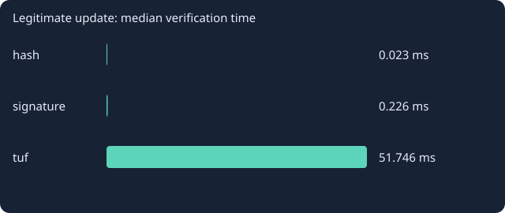
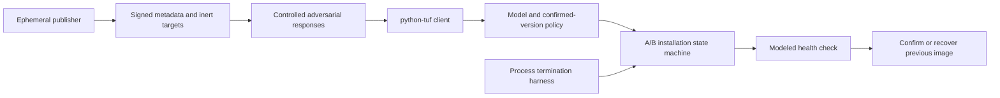

# UpdateGuard

[](https://github.com/thezanis11/updateguard/actions/workflows/checks.yml)

**Secure update verification and recoverable A/B installation, tested against adversarial responses and real process interruptions.**

Python · TUF · Ed25519 · persistent state machines · software supply chain security

UpdateGuard is a software-only engineering laboratory. It compares an unsigned hash, a fixed-key signature and a real `python-tuf` client, then tests a separate A/B installer by terminating a subprocess at durable state transitions. It uses inert, generated JSON artifacts; it never executes downloaded firmware.

## Read the results

- [Portable interactive report](reports/index.html): download the repository and open this file in a browser.
- [Measured results in French](reports/RESULTS_FR.md).
- [Raw verification decisions](reports/security.csv), [recovery trials](reports/recovery.csv), and [experiment manifest](reports/experiment.json).
- [Protocol and threat model](docs/METHOD.md).

The standard campaign measures **135 verifier decisions** (15 scenarios × 3 policies × 3 timing repetitions) and **30 hard process interruptions** (5 boundaries × 2 artifact sizes × 3 repetitions). Repetitions are not independent threat discoveries or a basis for a real-world security success rate.

Key findings to inspect:

- Replayed releases pass the hash and fixed-signature baselines; persistent TUF metadata rejects them.
- A valid root-authorized targets-key rotation works with TUF but breaks the naive fixed-key verifier.
- Compromise of all online roles permits maliciously signed updates in this configuration. The report includes this accepted case.
- Authenticity does not imply software health. An authentic unhealthy candidate is verified, but the installer keeps the previous confirmed image.
- Before health confirmation is persisted, recovery retains v1; after that boundary, recovery completes v2.



## Quick start

Python 3.11+ is declared; see the checks badge for the versions actually tested in CI. Local validation used Python 3.14 on Windows. No GPU, Linux, device hardware, account or paid service is needed.

Windows PowerShell, from the repository directory:

```powershell
python -m venv .venv
.\.venv\Scripts\python.exe -m pip install --require-hashes --only-binary=:all: -r requirements-lock.txt
.\.venv\Scripts\python.exe -m unittest discover -s tests -v
.\.venv\Scripts\python.exe -m updateguard.cli demo
Start-Process data/demo/index.html
```

On Linux/macOS, use `.venv/bin/python` instead. The HTTP test binds only to `127.0.0.1` on an automatically assigned port. Other tests and experiments use a deterministic in-memory transport with real signature and TUF checks.

Reproduce the complete campaign:

```powershell
.\.venv\Scripts\python.exe -m updateguard.cli benchmark --repetitions 3 --out reports
```

`demo` runs one repetition of the same protocol and writes a separate report under ignored `data/demo/`. It does not alter the committed measured report. Timing and randomized key-dependent artifacts vary between runs; acceptance decisions and recovery invariants should remain the same. An assertion mismatch makes the command fail, after preserving results for inspection.

## Architecture



- `repository.py`: generates short-lived Ed25519 signing keys and correctly linked root/targets/snapshot/timestamp metadata.
- `client.py`: uses the upstream TUF updater, persists trusted metadata and enforces application compatibility/version rules.
- `device.py`: maintains confirmed and candidate slots using atomic file replacement and a process-owned writer lock.
- `scenarios.py`: explicitly defines adversary capabilities and expected protocol decisions.
- `experiments.py`: collects measured outcomes, times, successful-transfer byte counts and source hashes.
- `tests/`: checks protocol boundaries, model/schema validation, floor persistence, key changes, actual HTTP, state recovery and writer exclusion.

Keys remain in memory and are regenerated per experiment. Only public dependency provenance, inert code, aggregate results and artifact hashes are committed. There is no production signing service, key vault or remote deployment command.

## Important boundaries

- This is **not a secure boot implementation, Uptane implementation, hardware emulator or certified updater**.
- The health check is a modeled boolean in an inert image. A real product needs independently observed health and a trusted boot chain.
- Root provisioning, protected local state, a sufficiently trustworthy clock and the security of the cryptographic libraries are assumptions.
- TUF root and each top-level role use one key with threshold one. Root-authorized targets-key rotation is tested; root-key rollover and threshold signing are outside this V1.
- The installer accepts already-verified bytes through an internal API. Direct use of that API bypasses authentication; only the demonstrated verification-to-installation flow represents the intended composition.
- Process exits at persisted boundaries do not model torn flash writes, filesystem/controller power-loss behavior or hostile local administrators.
- TUF refresh may reject an update while the device continues running its last confirmed version. Preventing a bad update does not guarantee availability of a new one.
- Two concurrent operations on the same state directory are rejected by OS locks. A multi-device deployment coordinator is outside scope.
- Results were inspected during development: this is an exploratory engineering evaluation, not a blind audit or proof of security.

## Learning and reproduction

[French learning guide](docs/GUIDE_FR.md) · [Five-minute demo](docs/DEMO_FR.md) · [Dependency provenance](docs/DEPENDENCY_PROVENANCE.json) · [Third-party notices](THIRD-PARTY-NOTICES.md)

The repository was developed with AI assistance. The guide includes exercises for independently understanding, modifying and defending the design choices in an interview. No production deployment or professional authorship claim is implied.

Code: [MIT](LICENSE). Third-party libraries retain their own licenses. No external dataset is redistributed.
